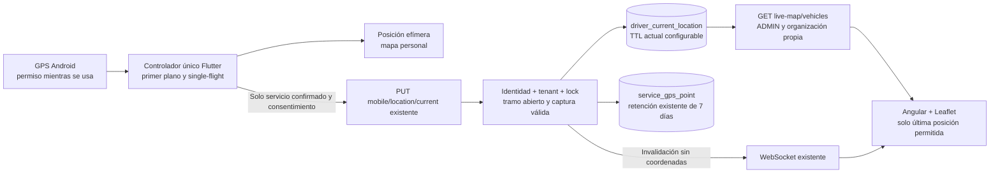

# Mapa en vivo — entrega local implementada

Implementación realizada entre el 11 y el 12 de noviembre de 2026 sobre el workspace actual. Incluye backend Spring Boot/PostgreSQL, CRM Angular y aplicativo Flutter. Las diez fases del objetivo están trazadas en `estado_fases.md`; el inventario y las huellas de los archivos se generan en `verificacion/artefactos/`.

## Comportamiento entregado

- **ADMIN:** Módulos → Monitoreo → Mapa en vivo y Acciones rápidas → Monitoreo en vivo abren `/live-map`. Se conserva el topbar existente. Solo aparecen unidades de su organización, con servicio confirmado en ejecución, consentimiento y ubicación autorizada no caducada.
- **CRM:** grupo operativo, nombre del conductor y límites 5/10/15/20; listado, agrupamiento por proximidad, selección coordinada, popup, zoom, centrar y ficha existente del vehículo. Datos visibles: conductor, placa y hora de captura. Verde antes de 120 segundos; gris desde 120 segundos; retirada al vencer el TTL del servidor o perder autorización. No se inventan desplazamientos ni se dibuja un recorrido supuesto.
- **CONDUCTOR:** Inicio, Disponibilidad, Asignaciones, Mapa y Más. Más conserva Incidencias, Comunicados y Perfil, incluidas sus rutas consultivas existentes. El mapa personal puede capturar posición local sin aceptar una oferta y sin subir coordenadas a Ruta Fija.
- **Servicio:** «Ver mapa» desde una asignación iniciada reutiliza la misma pantalla. El único controlador GPS conserva la cadencia aproximada de 30 segundos y su bloqueo de concurrencia. Compartir requiere servicio confirmado, consentimiento, permiso, GPS, primer plano y conexión. Mapa personal y servicio no crean capturadores paralelos.
- **Privacidad:** retirar consentimiento bloquea inmediatamente futuros envíos locales, invalida resultados pendientes y elimina el snapshot en el servidor. Background y cambios de sesión invalidan resultados; no hay cola GPS ni envío posterior de muestras. La atribución cartográfica está enlazada y el móvil informa del tráfico de IP/viewport antes de mostrar teselas.
- **Cierre:** «Ruta finalizada» llama al flujo existente de completar servicio, con sus comprobaciones, confirmación y recuperación del resultado. Regresar a la asignación no completa el servicio. Esa declaración no demuestra por sí sola un recorrido físico.
- **SUPER_ADMIN:** mantiene su navegación de plataforma y no obtiene acceso al feed GPS; la API lo rechaza con 403.

## Flujo real y persistencia



No se añade una tabla ni migración Flyway. Se reutilizan V1–V51, el snapshot, los tramos, las asignaciones, los vehículos y las membresías activas. No se elimina ni amplía el historial original de otros flujos. El gris de 120 segundos no cambia el TTL existente de cinco minutos por defecto.

## API y permisos

| Ruta | Uso | Permiso |
|---|---|---|
| `GET /api/v1/live-map/vehicles` | Proyección mínima; `limit`, `groupId`, `driverName` | ADMIN; tenant derivado de sesión |
| `GET /api/v1/live-map/groups` | Grupos activos propios, solo ID y nombre | ADMIN |
| `PUT /api/v1/mobile/location/consent` | Consentimiento revocable existente | CONDUCTOR, identidad propia |
| `PUT /api/v1/mobile/location/current` | Captura existente, solo tramo autorizado | CONDUCTOR propio en servicio |
| `DELETE /api/v1/mobile/location/current` | Retirada puntual; no revoca consentimiento | CONDUCTOR propio |
| `POST /api/v1/mobile/assignments/{id}/complete` | Cierre existente, sin transición nueva | CONDUCTOR responsable y validaciones actuales |

El contrato coordinado está en `CONTRATO_MODULO.md`. Los GET nuevos llevan `Cache-Control: no-store`. No se acepta organización elegida por cliente. Nombre máximo 100 caracteres, búsqueda literal parametrizada, límites admitidos 5/10/15/20, orden estable por captura y conductor. Grupos ajenos no revelan existencia. La respuesta contiene `serverTime`, identificadores, nombre/placa, coordenadas para dibujar, `capturedAt`, `receivedAt`, `expiresAt` y frescura; esos campos técnicos no convierten el popup en un historial o exportación de GPS.

## Verificación ejecutada

| Superficie | Resultado y evidencia |
|---|---|
| Backend de referencia y regresión | 261 pruebas / 51 clases, sin conectar bases compartidas. Regresión final: `docs/evidencia/auditoria-ide-2026-10-23/backend/run-90cd4482-ed54-4bf5-ba8b-be07f2178632/result.json` |
| Backend nuevo | 18 pruebas unitarias; package/JAR correcto. `verificacion/backend/04-final-package.log` |
| PostgreSQL exclusivo | 14 casos ejecutados, incluido el exportador opcional de fixture; roles, tenant, términos/identidad reales, filtros literales, 120 s, TTL, revocación y cierre. `verificacion/postgres/integration-20261112T030913Z.log` |
| Carreras reforzadas | Dos casos adicionales esperan en PostgreSQL el bloqueo del PID concreto antes de revocar/completar; ambos PASS. `verificacion/postgres/integration-20261112T031257Z.log` |
| CRM | Typecheck PASS; regresión 65 archivos / 457 pruebas PASS; 22 pruebas dirigidas después del ajuste de contraste y build de producción PASS. `verificacion/frontend/10-typecheck.log`, `11-full-regression.log`, `14-contrast-focused.log`, `15-contrast-build.log` |
| Flutter | Analyze sin incidencias; regresión final 256 PASS, ocho omisiones: siete preexistentes y la integración opcional sin entorno. Las tres etapas HTTP opcionales se ejecutaron aparte con entorno real. `verificacion/mobile/analyze-closure.log`, `regression-closure.log`; el widget de cierre confirmado y retorno tiene caso positivo adicional en `completion-route-positive.log` |
| Cliente Flutter real → API → PostgreSQL | Publicación confirmada en feed ADMIN; revocación con mapa personal sin subida; completar por endpoint vigente y seguir usando mapa personal sin subida. `verificacion/postgres/flutter-http-publish.json`, `flutter-http-revoke.json`, `flutter-http-complete.json` |
| Brave con API real | Login/guard, marcador, selección, filtros, límites, vacío, teclado y reflow 720/360; la revocación retira la unidad del CRM abierto. `verificacion/browser/result-initial.json`, `result-watch-revocation.json` |
| Revisión visual actual | Cinco unidades explícitamente sintéticas y teselas de prueba; Angular y autenticación reales, feed visual interceptado. `verificacion/browser/result-visual.json` y PNG con sufijo `visual-synthetic` |
| Accesibilidad | Axe: cero infracciones detectadas en el main; contraste automático incompleto en Brave, complementado con cálculo de los cuatro textos corregidos y sus fondos. Reflow equivalente a 200 % mediante viewport CSS 720 px y escala 2, más Flutter a texto 200 %. No se afirma certificación WCAG ni prueba de lector de pantalla humano |
| APK | Build debug PASS, archivo real y metadatos revisados; paquete `pe.rutafija.conductor`, versionCode 2, mínimo Android 10 preservado, target 36. Sin permiso de ubicación background. Alcance de aceptación nuevo: Android 12+ |

Los nombres exactos de logs fechados se consolidan en el inventario. Los errores iniciales se conservaron como diagnóstico; los PASS anteriores no sustituyen la evidencia final. Los incrementos RED/GREEN están en los subdirectorios backend/frontend/mobile; no se afirma que todo el proyecto se haya desarrollado con TDD.

JaCoCo del paquete nuevo: 38/40 líneas cubiertas en datos agregados de las ejecuciones seleccionadas (`verificacion/backend/jacoco-livemap.json`). El informe general tiene avisos de clases históricas ajenas con huellas diferentes y no se usa para afirmar cobertura del sistema completo.

## Artefactos y uso local

- JAR: `backend/target/ruta-fija-backend-0.1.0-SNAPSHOT.jar`.
- CRM compilado: `frontend/dist/ruta-fija-crm/browser/`.
- APK debug: `mobile/build/app/outputs/flutter-apk/app-debug.apk`.
- SHA-256 y metadatos: `verificacion/artefactos/manifest-entrega.json` y `apk-badging.txt`.

Desde PowerShell en la raíz, el procedimiento nativo existente sigue siendo el de los scripts `Invoke-RutaFijaPostgresqlLease.ps1` e `Invoke-RutaFijaNativeRuntime.ps1`; su arranque conserva las verificaciones de esquema y no migra la base de uso diario. La implementación se verificó contra un clúster distinto, no arrancando el producto sobre datos reales.

Desde `mobile`, recompilar para un dispositivo exige `RF_API_BASE_URL` accesible desde ese dispositivo. El APK debug entregado conserva la URL por defecto del emulador `http://10.0.2.2:8080/api/v1`; no contiene credenciales. Release sigue exigiendo HTTPS y firma explícita. No se instaló sobre el teléfono del usuario ni se borraron datos o sesiones.

La configuración pública de teselas Angular está en `frontend/public/config/live-map.json`; Flutter admite `RF_MAP_TILE_URL` al compilar. Solo HTTPS XYZ sin credenciales ni query de facturación. Leaflet 1.9.4 y flutter_map 8.3.2 se fijaron en lockfiles. Las licencias locales y la atribución acompañan al código; la caché de imágenes HTTP no es soporte offline ni cola de ubicaciones.

## Reproducción de la integración aislada

```powershell
python .\docs\mapa-en-vivo\verificacion\postgres_aislado.py start
# Solo para repetir una suite completa en SU base desechable, con API de pruebas detenida:
python .\docs\mapa-en-vivo\verificacion\postgres_aislado.py reset
python .\docs\mapa-en-vivo\verificacion\postgres_aislado.py test --browser-fixture
python .\docs\mapa-en-vivo\verificacion\integracion_completa.py initial
python .\docs\mapa-en-vivo\verificacion\integracion_completa.py close
python .\docs\mapa-en-vivo\verificacion\integracion_completa.py visual
python .\docs\mapa-en-vivo\verificacion\integracion_completa.py performance
python .\docs\mapa-en-vivo\verificacion\postgres_aislado.py stop
```

Requiere las herramientas ya presentes y el classpath de Maven generado durante esta entrega. Los guards fijan PostgreSQL16 en `127.0.0.1:54432/rf_map_test`, su directorio privado y el usuario exclusivo; rechazan la base compartida. `reset` recrea exclusivamente esa base desechable y archiva su fixture privado; no fuerza conexiones abiertas. Las pruebas con commit consumen las cuotas del piloto: no se deben ejecutar repetidamente sobre una base compartida ni desactivar sus triggers. Secretos de prueba solo en `.runtime/live-map-isolated`, con ACL restringida, nunca en documentación o mensajes. Las rutinas de integración heredadas con limpieza global no se ejecutaron.

## Diferencias visuales justificadas

| Referencia | Entrega |
|---|---|
| CRM Main aprobado, mapa izquierdo/lista derecha | Se conserva composición, paleta y relaciones; se añade aviso cartográfico y estados verificables |
| Controles pequeños del boceto | Objetivos táctiles mayores, foco visible y colores oscuros medidos para legibilidad |
| Unidades de ejemplo y calles ilustrativas | Producción usa la API autorizada y teselas configuradas; capturas de QA usan datos y cuadrícula sintéticos rotulados |
| Stitch con barra distinta del producto | Cinco accesos confirmados por usuario; Más conserva los tres destinos anteriores |
| «Ruta finalizada» de la maqueta | Etiqueta nueva en mapa, misma operación de completar y confirmación existentes |
| Bocetos con buscador de zonas o cola offline | Esos elementos históricos no se incorporan al alcance aprobado |

La lectura visual final confirmó cabecera móvil negra, tarjetas crema, botones amarillos, automóvil propio, controles y atribución. Los PNG Flutter provienen de widgets renderizados con sensor/teselas sintéticos; no son capturas de un teléfono real. Los PNG de diagnóstico antiguos no se usan como comparación final.

## Límites expresos y decisiones pendientes

1. **Aceptación física Android pendiente:** no había un dispositivo conectado al comprobar ADB. Faltan observación de permiso OS, GPS real, batería, bloqueo/reapertura y accesibilidad con ayudas reales. No se afirma compatibilidad física probada por tener un APK.
2. Una captura nativa ya iniciada puede terminar o vencer hasta su timeout de 15 s. El controlador invalida su resultado y detiene futuros envíos; no se acredita apagado instantáneo del hardware GPS.
3. **Despliegue externo y escala futura pendientes:** el usuario confirmó mantener cuatro ADMIN y veinte CONDUCTOR globales. No se amplían cuotas para simular cinco ADMIN y doscientos conductores. El ensayo básico de rendimiento serial se identifica como tal y no certifica esa capacidad.
4. Proveedor OSM público comprobado mediante una única petición HEAD de metadatos, sin descargar imagen ni enviar GPS. Sus políticas no ofrecen servicio ilimitado ni SLA. No hay hosting ni proveedor de producción contratados o aprobados; no se efectuó un despliegue externo ni pagos.
5. Aviso, consentimiento funcional existente y minimización técnica están integrados; la aprobación legal y operacional para producción corresponde al responsable. La aceptación de teselas no autoriza compartir GPS con la organización.

Medición básica local: veinte lecturas seriales autorizadas con conjunto vacío, p50 57.56 ms y p95 117.35 ms en esa ejecución, sin peticiones a teselas públicas. Es una muestra de latencia de la consulta vacía, no una prueba de carga con flota, concurrencia o SLA.

## Reversión local

La línea base de fuentes se conserva en `verificacion/baseline/fuentes/` con sus huellas. Para revertir un lote, detener sus procesos y restaurar **solo los archivos modificados** que indique el manifiesto, conservando cambios ajenos. Retirar los archivos nuevos del módulo y sus metadatos de navegación de manera coordinada; restaurar los lockfiles y reconstruir las tres superficies. No es necesario revertir una migración del mapa porque no se creó ninguna. No restaurar ni limpiar bases reales como parte de esa reversión. La restauración de archivos puede comprobarse por SHA; no se presenta como un ensayo de recuperación de datos de producción.
